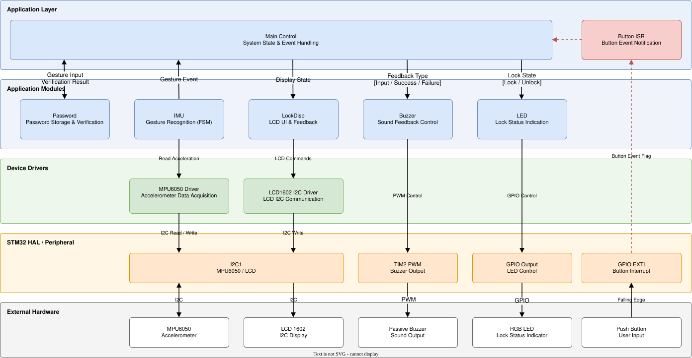
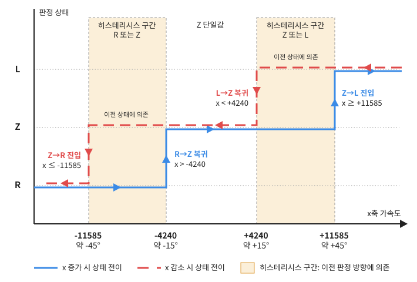
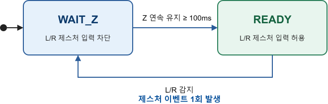

## Overview

**Gesture Lock System**

가속도 센서의 좌우 기울기 패턴을 비밀번호로 사용하여 잠금 상태를 제어하는 시스템입니다.

기존 숫자 키패드 방식은 반복적으로 누르는 버튼에 지문 흔적이 남아 비밀번호가 추측될 가능성이 있습니다.

이를 줄이기 위해 숫자 버튼 대신 가속도 센서의 좌우 기울기로 비밀번호를 입력하고, 입력된 패턴을 검증하여 잠금 상태를 제어하는 시스템을 구현했습니다.

**Key Features**

- 좌우 기울기 패턴을 이용한 비밀번호 입력 및 검증
- FSM 기반 중립 상태 확인 및 제스처 중복 인식 방지
- 비밀번호 검증 결과에 따른 잠금 상태 전환
- LCD, LED, 부저를 활용한 입력 과정 및 인증 결과 피드백

## System Architecture

### Component Responsibilities

| 구성요소 | 역할 |
|---|---|
| STM32 (NUCLEO-F446RE) | 센서 데이터 처리, 비밀번호 검증 및 시스템 상태 관리 |
| MPU6050 | 3축 가속도 데이터 측정 |
| Push Button | 비밀번호 검증 요청 및 잠금 상태 전환 입력 |
| LCD 1602 (I2C) | 문자 및 상태 메시지 출력 |
| RGB LED | 잠금 상태에 따른 LED 색상 출력 |
| Passive Buzzer | 입력 및 인증 결과에 따른 소리 출력 (진동 대체) |

## Key Implementation

### Core Features

| 핵심 구현 | 설명 | 관련 기술 |
|---|---|---|
| 가속도 센서 데이터 처리 | MPU6050의 X축 가속도 데이터를 읽고 좌우 기울기 방향 판정 | I2C, STM32 HAL |
| 제스처 입력 인식 | 히스테리시스와 FSM을 이용한 유효 제스처 판정 및 중복 입력 방지 | Hysteresis, FSM |
| 비밀번호 검증 | 입력된 제스처 패턴과 설정된 비밀번호 비교 | C, Pattern Matching |
| 사용자 피드백 | 입력 과정과 인증 결과에 따라 LCD, LED, 부저 제어 | GPIO, I2C, PWM |

### Gesture Recognition

MPU6050의 X축 가속도 데이터를 이용해 센서의 좌우 기울기를 판정하고, FSM을 통해 유효한 제스처 입력 이벤트를 생성합니다.

- **Direction Detection:** 가속도 임계값을 기준으로 좌측(L), 중립(Z), 우측(R) 상태 판정
- **Hysteresis:** 방향 진입과 중립 복귀에 서로 다른 임계값을 적용하여 경계 부근의 상태 변동 감소
- **Z Hold Time:** 중립 상태가 일정 시간 유지된 경우에만 새로운 제스처 입력 허용
- **FSM:** `WAIT_Z`와 `READY` 상태를 통해 제스처 입력 가능 조건 관리

## Engineering Challenges

### 제스처 중복 인식 및 오인식 문제 개선

**1. 문제 발생**

- 센서를 한 방향으로 기울이는 과정에서 동일한 제스처가 반복적으로 인식되는 문제가 발생했습니다.
- 히스테리시스를 적용한 이후에도 센서 값이 순간적으로 중립 범위에 진입하면 새로운 제스처 입력이 허용되는 문제가 남아 있었습니다.

**2. 문제 원인**

- 임계값만으로 방향을 판정하는 방식에서는 센서값의 변동으로 방향 상태가 반복적으로 변경될 수 있었습니다.
- 히스테리시스를 적용하더라도 중립 상태의 유지 시간을 확인하지 않아, 순간적인 중립 진입이 다음 제스처 입력을 허용하는 조건으로 처리되었습니다.

**3. 설계 개선**

- 방향 진입과 중립 복귀에 서로 다른 임계값을 적용하여 경계 부근의 상태 변동을 줄였습니다.
- FSM을 통해 중립 상태 확인과 제스처 입력 가능 상태를 구분했습니다.
- 중립 상태가 100ms 이상 유지된 경우에만 새로운 제스처를 허용하도록 개선했습니다.

**Hysteresis Thresholds**

**Gesture Recognition FSM**

**4. 결과**

- UART 로그를 통해 방향 판정 결과, FSM 상태 전이, 제스처 이벤트 발생 여부를 확인했습니다.
- 중립 상태 유지 조건을 만족하지 않는 짧은 변화에서는 새로운 제스처 이벤트가 발생하지 않는 것을 확인했습니다.

## Demo Video

